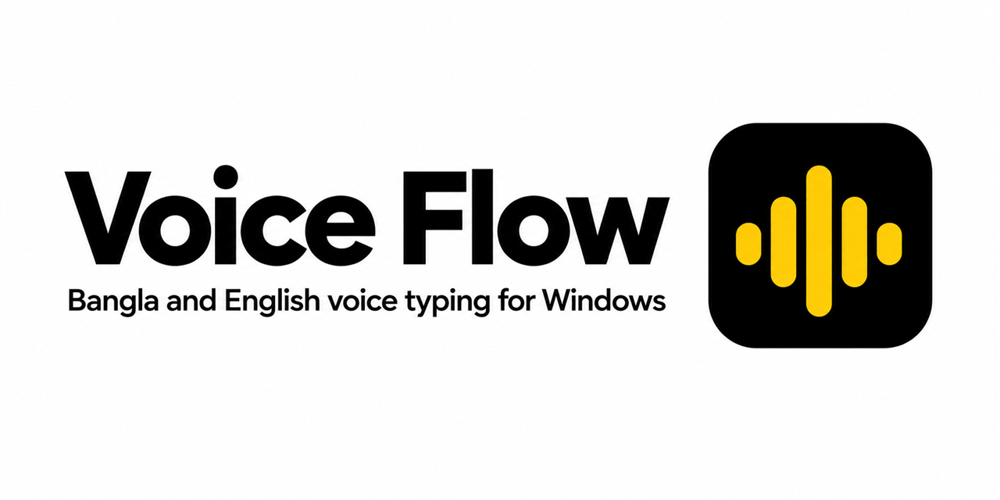
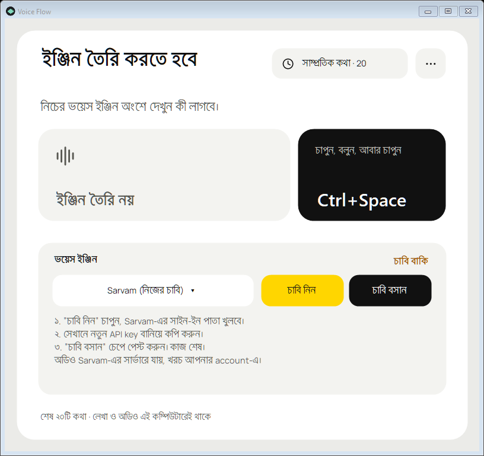
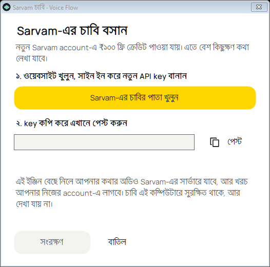

<p align="center"></p>

# Voice Flow

Bangla and English voice typing for Windows. Press **Ctrl+Space**, speak, press **Ctrl+Space** again. The text appears where your cursor is, in any app.

<p align="center"> </p>

> The app's own interface is in Bangla. This repository (docs, code comments, issues) is in English.

**New here?** Start with the [step-by-step guide](docs/GETTING-STARTED.md). Stuck? Give this repository link to an AI assistant and ask it to walk you through the docs.

## Install

1. Download `VoiceFlow-0.3.3-Setup.exe` from [Releases](../../releases/latest) and run it.
   Requires Windows 10 or 11 (x64) and .NET Framework 4.7.2 or newer. Node.js is bundled.
2. Open Voice Flow and pick a voice engine (see below).
3. Put the cursor where you want text. Press **Ctrl+Space**, speak, press **Ctrl+Space**. **Esc** cancels.

The installer is not code-signed yet, so Windows SmartScreen may warn you. Compare the file's SHA-256 with `SHA256SUMS.txt` on the release page before running it.

**Virus scan:** [VirusTotal report for the v0.3.3 installer](https://www.virustotal.com/gui/file/4c99026cf79cd7253ac4ea8ae35babd0943237bb67b0a53a089f96b922bfee67). Microsoft Defender, ESET, Symantec, Sophos, Malwarebytes, CrowdStrike, Trend Micro and most others found nothing. 4 of 52 machine-learning or reputation scanners flagged it, which is common for a new, unsigned installer that bundles Node.js. All source code is in this repository, and you can build the installer yourself.

## Voice engines

| Engine | Internet | Cost | Setup |
|---|---|---|---|
| **Local model** | Once, to download it (about 71 MB). Then none. | Free | Press the download button ("লোকাল মডেল নামান") |
| **Sarvam** | Yes | Your own Sarvam account | Press "চাবি নিন" (Get key): their key page opens. Create a key, copy it, press "চাবি বসান" (Paste key), paste |
| **Chariot** | Yes | Your own Chariot account | Same as Sarvam |

The app shows these steps for the engine you pick. Audio goes only to the engine you chose; with the local model it never leaves your computer. Details: [privacy](docs/PRIVACY.md), [engines and keys](docs/ENGINES.md), [FAQ](docs/FAQ.md).

If Sarvam or Chariot fails and the local model is installed, the same recording is re-read by the local model, and the caption card says so.

## Features

- A small caption card shows the text while you speak. It never takes focus.
- If pasting is not possible, the text stays on the clipboard.
- The history window ("সাম্প্রতিক কথা", Recent) keeps your last 20 recordings with text and audio, encrypted for your Windows user. Play, copy, retry or delete any of them.
- Closing the window keeps the app in the tray. Quit from the tray menu.
- Keys are stored with Windows DPAPI. Nothing is uploaded automatically.

Accuracy depends on the engine, your microphone and how you speak. This project makes no accuracy, speed or cost promises for third-party services.

## Report a problem

In the app, open the "···" menu and choose "সমস্যা জানান" (Report a problem). It opens the GitHub issue form in your browser; you write and submit it yourself. Do not post passwords, keys or private audio. See [docs/TROUBLESHOOTING.md](docs/TROUBLESHOOTING.md).

## Build from source

Needs the .NET Framework compiler that ships with Windows, and Node.js 24 or newer.

```powershell
npm ci
.\build.ps1                  # builds VoiceFlow.exe
npm test                     # helper tests
.\VoiceFlow.exe --self-test  # native checks in an isolated data folder
.\package-release.ps1        # builds dist\VoiceFlow-0.3.3-Setup.exe
```

Project layout: `src/` (C# WinForms app), `bridge/` (Node helper and engines), `setup/` (installer), `docs/`.

## Contributing

Issues and pull requests are welcome. See [CONTRIBUTING.md](CONTRIBUTING.md).

## License

[MIT](LICENSE). Third-party components and the downloaded model have their own licenses: [THIRD-PARTY-NOTICES.md](THIRD-PARTY-NOTICES.md).
